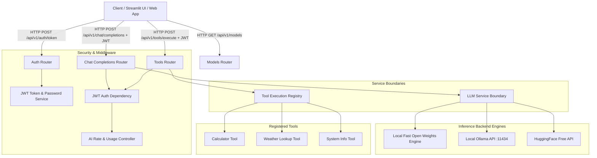

# System Architecture & Technical Documentation

## Overview
The **FastAPI Open LLM Microservice** is a production-grade, containerized AI service architecture designed to run open-weights language models locally or via free-tier API endpoints. The microservice enforces strict data validation via **Pydantic v2**, secures endpoints with **JWT authentication**, and manages compute quotas using an **AI-specific sliding-window rate limiter**.

---

## 🏗️ System Architecture Diagram

---

## 🚀 Key Architectural Layers

### 1. Strict Typing & Pydantic v2 Schema Validation
- All request payloads (`ChatCompletionRequest`, `UserCreate`, `ToolExecutionRequest`) and response contracts (`ChatCompletionResponse`, `UserResponse`, `Token`) strictly extend Pydantic v2 `BaseModel`.
- Configured with `ConfigDict(from_attributes=True)` and strict type annotations (`Annotated`, `Field`, `EmailStr`).

### 2. Authentication & Authorization Integration
- Uses standard OAuth2 Password Bearer flow.
- Password hashing powered by `bcrypt`.
- JWT access tokens generated using `pyjwt` containing `sub` (username), `role` (claims), `iat`, and `exp`.

### 3. AI-Specific Rate & Usage Controls
- Sliding-window memory tracker enforcing dual quotas:
  - **RPM (Requests per Minute)**: Default cap of 20 req/min per user.
  - **TPM (Tokens per Minute)**: Default cap of 10,000 tokens/min per user.
- Emits standard HTTP `429 Too Many Requests` status with `Retry-After: 60` headers when exceeded.

### 4. Decoupled Model & Tool Service Boundaries
- **LLM Service Boundary (`app/services/llm_service.py`)**: Abstracted interface supporting local fast execution, Ollama integration, HuggingFace free API, and OpenRouter. Handles prompt template compilation and structured JSON enforcement.
- **Tool Service Boundary (`app/services/tool_service.py`)**: Sandboxed registry protecting against unsafe evaluation while enabling model tool use (`calculator`, `weather_lookup`, `system_info`).

---

## 🛠️ Package Management & Production Toolchain
- **`uv`**: Rapid dependency management via `pyproject.toml`.
- **Ruff & Mypy**: Automated code quality linting and static type checking.
- **GitHub Actions**: Continuous Integration pipeline checking linting, type safety, and unit test execution.
- **Docker Multi-Stage Build**: Minified runtime container executed as non-root user (`appuser`).
