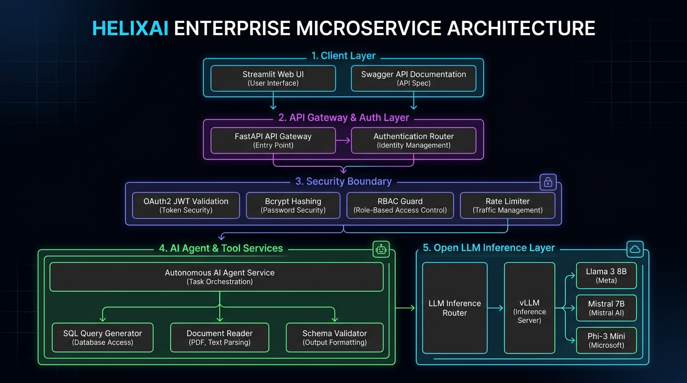

# HelixAI Architecture & Technical Documentation

## Overview
**HelixAI** is a production-grade, containerized FastAPI microservice purpose-built for **Data & AI Engineering workloads**. It hosts **Open Weights Language Models** (Llama 3 8B, Mistral 7B, Phi-3 Mini) locally or via open API backends. The microservice enforces strict data validation via **Pydantic v2**, secures endpoints with **OAuth2 JWT authentication**, implements **Role-Based Access Control (RBAC)**, tracks quotas with an **AI-specific sliding-window rate limiter (RPM/TPM)**, executes **Autonomous SQL & Document RAG Agents**, and provides a Streamlit workspace.

---

## 🏗️ System Architecture Diagram



### 📊 Interactive Mermaid Flowchart Code

```mermaid
graph TD
    %% Client Layer
    subgraph Client & Interface Layer
        UI[Streamlit Dashboard UI :8501]
        Swagger[FastAPI Swagger Docs :8000/docs]
        HTTPClient[External Microservice HTTP Clients]
    end

    %% API Routing Layer
    subgraph FastAPI Microservice API Gateway
        UI & Swagger & HTTPClient -->|POST /api/v1/auth/token| AuthRouter[OAuth2 Auth Router]
        UI & Swagger & HTTPClient -->|GET /api/v1/models| ModelsRouter[Models Router]
        UI & Swagger & HTTPClient -->|POST /api/v1/chat/completions + JWT| ChatRouter[Chat Completions Router]
        UI & Swagger & HTTPClient -->|POST /api/v1/agent/run + JWT| AgentRouter[Autonomous Agent Router]
        UI & Swagger & HTTPClient -->|POST /api/v1/tools/execute + JWT| ToolsRouter[Tools Registry Router]
    end

    %% Security & Authorization Guard Layer
    subgraph Security & RBAC Guard Boundary
        AuthRouter --> BcryptJWT[Bcrypt Password Hashing & Signed JWT Issuer]
        ChatRouter --> JWTAuth[JWT Auth Dependency Guard]
        AgentRouter --> JWTAuth
        ToolsRouter --> JWTAuth
        
        JWTAuth --> RBACChecker[RBAC PermissionChecker Guard]
        RBACChecker --> RateLimiter[AI Sliding-Window Rate Limiter (RPM / TPM)]
    end

    %% Agent & Tool Service Boundary
    subgraph Service Boundaries
        AgentRouter --> AgentExecutor[Autonomous Agent Routing Engine]
        ToolsRouter --> ToolService[Tool Execution Service]
        ChatRouter --> LLMService[LLM Service Boundary]
        
        AgentExecutor --> ToolService
        AgentExecutor --> LLMService
        ToolService --> GroundedAnalyzer[Grounded Document & CSV Analyzer]
    end

    %% Open Model Inference Engines
    subgraph Open LLM Inference Layer
        LLMService --> LocalFastEngine[Local Open Weights Fast Engine]
        LLMService --> Ollama[Local Ollama API :11434]
        LLMService --> HF[HuggingFace Free API]
    end

    %% Sandboxed Tool Registry
    subgraph Data & AI Engineering Tool Matrix
        ToolService --> SQLTool[sql_data_analyst_tool: SQL Gen, Dialect Translation, DDL, Plan Optimizer]
        ToolService --> DocTool[pdf_csv_web_researcher: CSV Data Analytics, PDF Q&A, Web Search RAG]
        ToolService --> SchemaTool[data_schema_validator: Pydantic v2 & JSON Schema Quality]
        ToolService --> TextTool[text_summarizer: Executive Text Compression]
        ToolService --> CalcTool[calculator: Sandboxed Math AST Engine]
    end
```

---

## 🚀 Key Architectural Layers

### 1. OAuth2 JWT Authentication & Multi-Role RBAC Guard
- **Authentication**: OAuth2 password flow with bcrypt password hashing (`passlib`/`bcrypt`). Issues signed PyJWT access tokens containing user ID, role claims, and expiration.
- **RBAC Roles**: 4 granular role levels:
  - **Admin (`admin_user`)**: Full system access, dynamic rate limit adjustments, tool execution, and raw JWT inspections.
  - **Data Engineer (`data_eng_user`)**: Access to SQL agent, dialect translation, and schema validation tools.
  - **Analyst (`analyst_user`)**: Access to document Q&A, CSV analytics, web research, and analytical reporting.
  - **User (`demo_user`)**: Standard model inference access.
- **Runtime Enforcers**: Enforced at the route level via FastAPI `PermissionChecker(Permission.XXX)` dependency guards.

### 2. Dual-Quota Sliding Window Rate Limiter
- Memory-efficient sliding-window rate tracker enforcing dual quotas per user:
  - **RPM (Requests Per Minute)**: Default limit of 20 req/min per user.
  - **TPM (Tokens Per Minute)**: Base limit of 10,000 tokens/min per user.
- **Dynamic Quota Adjustment**: Administrators can adjust tenant TPM limits on the fly (e.g. `10,000` $\rightarrow$ `25,000` TPM) to support heavy batch ETL workloads.
- Emits HTTP `429 Too Many Requests` status with `Retry-After: 60` headers when exceeded.

### 3. Autonomous AI Data Analyst & Web Researcher Agent
- **Task Routing**: Autonomous multi-tool orchestration for natural language goal prompts:
  - **SQL Generation & Translation**: Generates dialect-aware SQL (PostgreSQL, Snowflake, BigQuery), validates DDL schemas, and generates execution plans.
  - **Document & CSV RAG**: Grounded CSV parsing (`amount_usd`, `revenue`, `region` statistics), PDF/text passage extraction, and live DuckDuckGo web search synthesis.
  - **Schema Validation**: Pydantic v2 JSON data quality and missing field analysis.

### 4. Open Model Local Inference Boundary (`llm_service`)
- Manages inference execution across local open-weights engines:
  - **Meta Llama 3 8B (`llama3-open-8b`)**: Reasoning, tool calling, and SQL generation.
  - **Mistral 7B (`mistral-7b-open`)**: Structured outputs and code generation.
  - **Phi-3 Mini (`phi3-mini-open`)**: Low-latency edge summarization.
- Supports local Ollama server integration (`:11434`), HuggingFace Inference API, and fast local simulation engine.

---

## 🛠️ Package Management & Production Toolchain
- **`uv`**: Rapid Python environment management via `pyproject.toml`.
- **Pytest**: Automated test suite (**22 passing unit tests** covering auth, RBAC, agent routing, rate limiting, and grounded document analysis).
- **Ruff & Mypy**: Automated code linting and static type checking.
- **Docker & Docker Compose**: Multi-stage containerized deployment.
