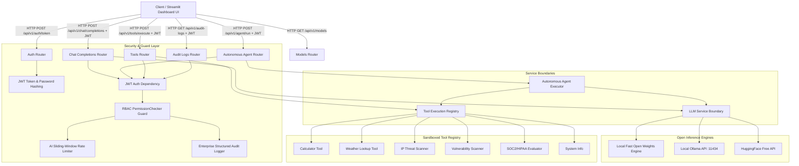

# HelixAI Architecture & Technical Documentation

## Overview
**HelixAI** is a production-grade, containerized FastAPI microservice for executing **Open Weights Language Models** (Llama 3 8B, Mistral 7B, Phi-3 Mini) locally or via free-tier API endpoints. The microservice enforces strict data validation via **Pydantic v2**, secures endpoints with **JWT authentication**, implements **Role-Based Access Control (RBAC)**, tracks quotas with an **AI-specific sliding-window rate limiter**, executes an **Autonomous AI Agent**, and maintains an **Enterprise Structured Audit Logger**.

---

## 🏗️ System Architecture Diagram

---

## 🚀 Key Architectural Layers

### 1. Strict Typing & Pydantic v2 Schema Validation
- All request payloads (`ChatCompletionRequest`, `UserCreate`, `ToolExecutionRequest`, `AgentRunRequest`) and response contracts (`ChatCompletionResponse`, `UserResponse`, `Token`, `AgentRunResponse`) strictly extend Pydantic v2 `BaseModel`.
- Configured with `ConfigDict(from_attributes=True)` and strict type annotations (`Annotated`, `Field`, `EmailStr`).

### 2. Multi-Role RBAC & Security Guards
- Roles: `admin`, `auditor`, `developer`, `user`.
- Fine-grained permissions: `chat:infer`, `tools:execute`, `audit:read`, `metrics:read`, `models:read`, `admin:all`, `policy:evaluate`.
- Enforced at runtime using FastAPI `PermissionChecker(Permission.XXX)` dependency guards.

### 3. Tenant Isolation & Enterprise Audit Logging
- Tenant context passed via `X-Tenant-ID` header.
- Structured Audit Logger (`AuditLogger`) records authentication attempts, authorization decisions, LLM inferences, and tool executions with timestamps and user metadata.

### 4. AI-Specific Rate & Usage Controls
- Sliding-window memory tracker enforcing dual quotas:
  - **RPM (Requests per Minute)**: Default cap of 20 req/min per user.
  - **TPM (Tokens per Minute)**: Default cap of 10,000 tokens/min per user.
- Emits HTTP `429 Too Many Requests` status with `Retry-After: 60` headers when exceeded.

### 5. Autonomous Multi-Tool AI Agent
- Evaluates user goal prompts, dynamically routes tasks to relevant tools (`ip_threat_lookup`, `vulnerability_scanner`, `compliance_evaluator`, `calculator`), and passes collected evidence to open LLMs for final report synthesis.

---

## 🛠️ Package Management & Production Toolchain
- **`uv`**: Rapid dependency management via `pyproject.toml`.
- **Ruff & Mypy**: Automated code quality linting and static type checking.
- **GitHub Actions**: Continuous Integration pipeline checking linting, type safety, and unit test execution.
- **Docker Multi-Stage Build**: Minified runtime container executed as non-root user (`appuser`).
